# AFK THEORY — Streetwear E-Commerce Platform

> **PAUSE THE GAME. KEEP YOUR STYLE.**  
> *Offline by choice. Away from keyboard. Same energy. Different reality.*

<p align="center">
  
</p>

<p align="center">
  
  
  
  
</p>

---

## 1. Brand Identity & Design Tokens

**AFK THEORY** is a modern, independent, premium-accessible streetwear brand launched in Bangladesh, debuting with oversized Drop Shoulder T-shirts with architecture ready for shirts, trousers, and outerwear.

### Central Color Palette
- **Graphite Black (`#292828`)**: Primary dark background for editorial contrast and brand strength.
- **Bone White (`#EDE6DC`)**: Clean, premium shopping background providing high contrast and calm aesthetic.
- **Electric Chartreuse (`#D8F452`)**: High-energy accent token for primary call-to-actions, badges, focus rings, and drop notifications.

### Brand Assets
- **Wordmark**: `apps/storefront/public/brand/logo-wordmark.png`
- **Icon / Favicon**: `apps/storefront/public/brand/pause-symbol.png`
- **Angular Emblem**: `apps/storefront/public/brand/logo-angular.png`
- **Chartreuse Badge**: `apps/storefront/public/brand/logo-chartreuse.png`

---

## 2. Monorepo Architecture

AFK THEORY is structured as a Turborepo monorepo with strict package boundaries:

```
afk-theory/
├── apps/
│   ├── backend/                 # Medusa v2.19 Headless Commerce & Administrator
│   │   ├── src/admin/          # Native Medusa Admin dashboard extensions
│   │   ├── src/migration-scripts/  # AFK THEORY seed workflow
│   │   ├── src/modules/        # Email, notifications & workflow modules
│   │   └── medusa-config.ts    # Manual payment (COD), Redis, Postgres config
│   │
│   └── storefront/              # Next.js 15.5 App Router Customer-Facing Storefront
│       ├── public/brand/       # Official AFK THEORY vector/raster brand assets
│       ├── src/app/            # Dynamic route tree ([countryCode], robots, sitemap)
│       ├── src/lib/constants/  # Bangladesh 64-district delivery definitions
│       └── src/modules/        # Checkout client, bag drawer, product templates
│
├── packages/
│   ├── commerce-contracts/      # Provider-independent commerce view models & BD constants
│   └── storefront-ui/           # Reusable Tailwind UI components, theme tokens & design system
│
├── docker-compose.yml           # Isolated PostgreSQL 16 & Redis 7 containers
└── scripts/                     # Boundary checkers and shared-ui AST auditors
```

---

## 3. Bangladesh Logistics & Delivery System

AFK THEORY features dedicated Bangladesh delivery routing with automatic district mapping and server-side shipping rate enforcement:

| Delivery Zone | Charge | Target Areas | Delivery SLA |
| :--- | :--- | :--- | :--- |
| **Inside Dhaka** | **৳60** | Dhaka City Corporation Metro (Banani, Gulshan, Dhanmondi, Uttara, Mirpur, Motijheel, etc.) | 24–48 Hours |
| **Dhaka Suburban** | **৳100** | Gazipur, Narayanganj, Savar, Keraniganj, Tongi, Ashulia, Dhamrai | 2–3 Business Days |
| **Outside Dhaka** | **৳130** | All remaining 60 districts across Chittagong, Sylhet, Rajshahi, Khulna, Barisal, Rangpur, Mymensingh | 3–5 Business Days |

### Phone & Address Integrity
- **11-Digit BD Phone Validation**: Enforces standard `01[3-9]\d{8}` format (e.g. `017XXXXXXXX`), normalizing inputs to standard local format for courier dispatch.
- **64 Administrative Districts**: Complete district selector with division groupings.
- **Zone Mismatch Guard**: Client and server-side validation prevents selecting an Inside Dhaka rate for an Outside Dhaka address.

---

## 4. Cash on Delivery (COD) Checkout

Cash on Delivery is the sole customer-facing payment option at launch:

1. **Clean Customer Flow**: No credit card forms, Stripe widgets, or fake test badges.
2. **Medusa Manual Provider**: Leverages Medusa v2's `pp_system_default` system provider labeled as "Cash on Delivery".
3. **Authorized Status**: Orders are created with authorized/pending payment status until physically collected by the delivery courier.
4. **Permanent Storage**: Orders are persisted in the real Medusa PostgreSQL database with tracking numbers and line items.
5. **Reconciliation**: Admins capture payment in the Medusa Admin dashboard once the courier remits funds.

---

## 5. Product Catalog & Draft Sample Fixture

The inaugural launch is architected around oversized Drop Shoulder T-shirts:
- **Sizes**: S, M, L, XL, XXL
- **Colors**: Graphite Black, Bone White, Electric Chartreuse
- **Measurements**: Chest width, body length, shoulder drop, and sleeve length.
- **Draft Fixture**: One configurable development fixture (`drop-shoulder-t-shirt`) is seeded in **DRAFT** status (`status: "draft"`), remaining unpublished until real production specs, GSM, and photography are supplied.
- **Sold-Out Testing**: Variant `AFK-DS-CHA-XXL` (XXL / Electric Chartreuse) is seeded with 0 stock to verify the sold-out badge and disabled add-to-cart state.

---

## 6. Local Setup & Quickstart Guide

### Prerequisites
- Node.js 20+
- pnpm 10.11+
- Docker Desktop (for PostgreSQL & Redis)

### Step 1: Start PostgreSQL & Redis
```bash
docker-compose up -d
```
*Containers `afk-theory-postgres` (port 5432) and `afk-theory-redis` (port 6379) will start.*

### Step 2: Configure Environment Files
Ensure `apps/backend/.env` and `apps/storefront/.env.local` exist:
```bash
# Backend (apps/backend/.env)
cp apps/backend/.env.template apps/backend/.env

# Storefront (apps/storefront/.env.local)
cp apps/storefront/.env.template apps/storefront/.env.local
```

### Step 3: Run Database Migrations & Initial Seed
```bash
cd apps/backend
pnpm medusa db:migrate
pnpm run seed
```
*This seeds the AFK THEORY store name, sales channel, 64-district delivery rates, categories, collections, and the draft Drop Shoulder fixture.*

### Step 4: Start Development Servers
From the repository root:
```bash
# Run both backend and storefront concurrently
pnpm run dev

# Or run individually:
pnpm --filter @dtc/backend dev      # Backend on http://localhost:9000
pnpm --filter @dtc/storefront dev   # Storefront on http://localhost:8000
```

### Step 5: Create Administrator & Medusa Admin Access
Create your secure administrator account using the Medusa CLI:
```bash
cd apps/backend
pnpm medusa user -e <your-admin-email> -p <strong-password>
```
*Never use default or shared passwords. Generate a unique, high-entropy password for administrator access.*

Open `http://localhost:9000/app` in your browser to log into the Medusa Admin dashboard to manage products, categories, inventory, and COD order reconciliations.

- **Admin URL**: [http://localhost:9000/app](http://localhost:9000/app)

---

## 7. Architecture & Quality Verification

Run validation scripts at any time to guarantee code quality and architecture boundaries:

```bash
# 1. Monorepo Boundary Enforcement (no cross-app pollution, no localStorage leaks)
node scripts/check-package-boundaries.mjs

# 2. Shared UI AST Adoption Check
node scripts/check-shared-ui.mjs

# 3. TypeScript Monorepo Type Check
pnpm run type-check

# 4. Production Storefront Build
pnpm --filter @dtc/storefront build
```

---

## 8. Technical SEO & Schema Specifications

- **Robots.txt**: Excludes checkout, cart, customer account, and admin endpoints while granting unrestricted access to catalog assets.
- **Dynamic XML Sitemap**: Auto-indexes all products, categories, and collections with priority weightings.
- **Structured Data (JSON-LD)**:
  - `Organization` schema with official brand metadata.
  - `Product` & `Offer` schema with BDT currency, InStock/OutOfStock states, and canonical URLs.
  - `BreadcrumbList` & `FAQPage` schemas for enhanced search snippets.
